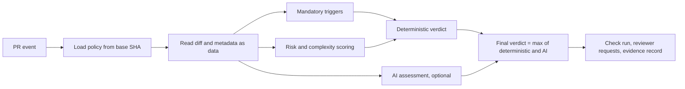

# Verdict model: deterministic floor, AI may only escalate, fail closed

## Context and Problem Statement

pr-riskinator combines deterministic rules with an optional AI assessment. The two sources can disagree, and the AI is neither reproducible nor robust to prompt injection. Auditors need the control to behave the same way every time it sees the same input. How do we combine the two signals into one verdict, and what happens when part of the evaluation fails?

## Decision Drivers

- Reproducibility: same diff, same policy, same tool version must give the same deterministic result (threat T10, audit sampling).
- Prompt-injection resistance: text in the PR must not be able to lower the verdict (T8).
- Fail-safe: an error must never produce a pass.
- Configurability: teams must be able to turn the AI on or off without changing the meaning of the deterministic result.

## Considered Options

1. Deterministic rules only
2. AI only
3. Weighted blend of deterministic score and AI score
4. Deterministic floor; final verdict is the maximum of the deterministic and AI results

## Decision Outcome

Chosen option: "Deterministic floor; final verdict is the maximum", because it keeps the auditable control fully deterministic while still letting the AI catch things the rules miss. An attacker who manipulates the AI can at worst cause extra human review.

### Verdict shape

```yaml
risk: low | medium | high            # ordinal
human_review: required | optional    # "optional" only for change classes enabled under ADR 0004 option B
bot_eligible: true | false           # always computed and recorded; acted on only for enabled classes (ADR 0004)
change_class: string | null          # standard-change class matched, if any (ADR 0004)
triggers: [rule IDs]                 # mandatory-review rules that fired (ADR 0006)
required_reviewers: [team slugs]     # routing derived from triggers and risk
reasons:                             # every factor that contributed, with evidence
  - rule: G3.lint-config
    file: .eslintrc.json
    detail: "file modified"
evaluation: ok | degraded | error
```

### Combination rules

1. The deterministic engine computes `risk_det` from scoring (ADR 0007) and applies risk floors from any triggers that fired (ADR 0006).
2. If the AI is enabled and returns a valid result, `risk_final = max(risk_det, risk_ai)`. If the AI is enabled but does not return a valid result, the `ai-unavailable` trigger fires and `risk_final = risk_det`. If the AI is disabled by policy, `risk_final = risk_det` and no trigger fires.
3. Any mandatory trigger sets `human_review: required`, regardless of risk.
4. The AI can add triggers of its own (for example "PR description does not match the diff"), which also require human review. It can never remove a trigger or lower a tier.

### Failure handling

| Condition | Result |
|---|---|
| Deterministic engine error, invalid diff, missing base policy | `evaluation: error`, `risk: high`, `human_review: required` |
| Repo policy invalid | Evaluate with org baseline and built-in defaults, add a `config-invalid` trigger, `human_review: required` (ADR 0010) |
| Diff above size cap | `oversize` trigger, `human_review: required`, AI skipped |
| AI enabled but timed out, errored, returned invalid output, or was skipped (for example over its token cap) | `evaluation: degraded`, `ai-unavailable` trigger, `human_review: required`, `bot_eligible: false`. Recorded in evidence. A successful re-run clears the trigger. |
| Forge API error while posting the result | The check stays pending or fails; it never reports success. |

### Re-running an evaluation

Transient failures (AI outage, forge API error) need a way to re-run without pushing a new commit. Re-runs must not become a way to re-roll the AI until it stops escalating.

Ways to trigger a re-run:

- The "Re-run" control on the App's check run (GitHub sends `check_run` with action `rerequested` to the App)
- A "Retry AI assessment" button on the check run (`requested_action`), shown only when the evaluation is degraded
- A PR comment `/riskinator rerun` from a user with write access

Semantics:

- The deterministic part is always recomputed. It is reproducible, so it gives the same result for the same inputs.
- AI runs that failed are executed again. Failures are never cached.
- Successful AI results are cached by input hash (ADR 0008). A re-run with unchanged inputs returns the cached result and does not call the model.
- **AI escalations are sticky per head SHA.** For a given head SHA, the verdict uses the highest AI risk and the union of AI triggers across every successful AI run. A later run can add escalations but never remove one. A new push (new head SHA) starts fresh.
- Re-runs are rate-limited per PR, and every re-run is recorded in the evidence with who triggered it.

### Pipeline



### Consequences

- Good, because the deterministic result alone is the control an auditor tests, and it is reproducible.
- Good, because prompt injection that tries to lower risk has no effect.
- Good, because the AI can be disabled per org or repo without changing what the deterministic result means.
- Bad, because a noisy AI can only add work. AI escalation precision must be measured (ADR 0013) and the AI turned down if it floods reviewers.
- Bad, because "max" discards cases where the AI is right that something is safer than the rules think. We accept that cost.

### Confirmation

- Property test: for any AI output, `risk_final >= risk_det` and the trigger set is a superset of the deterministic trigger set.
- Golden-fixture tests: fixed diffs produce fixed deterministic verdicts across releases.
- Fault-injection tests for every row in the failure table.
- Re-run tests: a failed AI run followed by a successful re-run clears `ai-unavailable`; a successful run followed by a re-run with unchanged inputs does not call the model; for one head SHA, a re-run that returns lower AI risk does not lower the verdict.

## Pros and Cons of the Options

### Deterministic rules only

- Good, because it is fully reproducible and simple to audit.
- Bad, because it misses semantic risks that do not match a path or pattern, such as auth logic moved into an unwatched file.

### AI only

- Good, because it understands intent and semantics.
- Bad, because it is not reproducible, can be prompt-injected into a low rating, and is hard to defend as a control.

### Weighted blend

- Good, because it uses both signals.
- Bad, because the AI can pull the verdict down, which reopens T8, and the result is not reproducible.

### Maximum of deterministic and AI

- Good, because it keeps determinism as the floor and makes manipulation useless for downgrading.
- Bad, because AI false positives add reviewer load.

## More Information

- Rewind's Diff Vader separates AI judgment from a deterministic verdict engine, but lets AI findings set the risk label. This ADR deliberately inverts that so the AI can only escalate.
